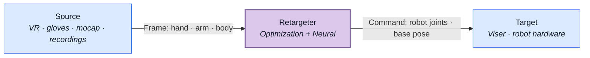

<p align="center">
  <a href="https://github.com/openrobokit/retargetingkit"></a>
</p>

<p align="center">
  <a href="pyproject.toml"></a>
  <a href="https://github.com/openrobokit/retargetingkit/actions/workflows/build.yml"></a>
  <a href="https://openrobokit.com/retargetingkit"></a>
  <a href="https://openrobokit.com/docs/retargetingkit/overview/"></a>
</p>

RetargetingKit maps live or recorded human motion to robot hands, arms, and humanoids using [RoboKit](https://github.com/openrobokit/robokit) optimization and neural hand models.

The two main applications are:

- 🎮 **Real-time teleoperation**
- ⚡ **Offline retargeting in parallel**

<p align="center">
  <a href="https://openrobokit.com/retargetingkit"></a><br>
  <em>Real-time teleoperation with dexterous hands and humanoids.</em>
</p>

<p align="center">
  <a href="https://openrobokit.com/retargetingkit"></a><br>
  <em>Body-and-hand retargeting in a furnished scene.</em>
</p>

## Quick links

- [Homepage](https://openrobokit.com/retargetingkit)
- [Docs](https://github.com/openrobokit/retargetingkit/blob/main/docs/guide/overview.md)
- [Quickstart](https://github.com/openrobokit/retargetingkit/blob/main/docs/guide/quickstart.md)
- [Installation](https://github.com/openrobokit/retargetingkit/blob/main/docs/guide/installation.md)
- [Development](https://github.com/openrobokit/retargetingkit/blob/main/docs/dev.md)

## Installation

Requires Python 3.10 or newer:

```shell
uv add retargetingkit      # or: pip install retargetingkit
```

See [Installation](https://github.com/openrobokit/retargetingkit/blob/main/docs/guide/installation.md) for source installs, extras, and asset access.

## Features

<table width="100%">
  <tr>
    <td width="33%" align="center" valign="top">
      <a href="https://github.com/openrobokit/retargetingkit/blob/main/docs/guide/hand_retargeting.md#work-with-trajectories"></a><br>
      <strong><a href="https://github.com/openrobokit/retargetingkit/blob/main/docs/guide/hand_retargeting.md#work-with-trajectories">Hand<br>retargeting</a></strong>
    </td>
    <td width="33%" align="center" valign="top">
      <a href="src/retargetingkit/gallery/hand_contact.py"></a><br>
      <strong><a href="src/retargetingkit/gallery/hand_contact.py">Geometry-aware hand<br>retargeting</a></strong>
    </td>
    <td width="33%" align="center" valign="top">
      <a href="https://github.com/openrobokit/retargetingkit/blob/main/docs/guide/hand_retargeting.md#preview-live-motion"></a><br>
      <strong><a href="https://github.com/openrobokit/retargetingkit/blob/main/docs/guide/hand_retargeting.md#preview-live-motion">Real-time hand<br>teleoperation</a></strong>
    </td>
  </tr>
  <tr>
    <td width="33%" align="center" valign="top">
      <a href="https://github.com/openrobokit/retargetingkit/blob/main/docs/guide/humanoid_retargeting.md"></a><br>
      <strong><a href="https://github.com/openrobokit/retargetingkit/blob/main/docs/guide/humanoid_retargeting.md">Humanoid<br>retargeting</a></strong>
    </td>
    <td width="33%" align="center" valign="top">
      <a href="src/retargetingkit/gallery/humanoid_terrain.py"></a><br>
      <strong><a href="src/retargetingkit/gallery/humanoid_terrain.py">Geometry-aware humanoid<br>retargeting</a></strong>
    </td>
    <td width="33%" align="center" valign="top">
      <a href="https://github.com/openrobokit/retargetingkit/blob/main/docs/guide/humanoid_retargeting.md"></a><br>
      <strong><a href="https://github.com/openrobokit/retargetingkit/blob/main/docs/guide/humanoid_retargeting.md">Real-time humanoid<br>teleoperation</a></strong>
    </td>
  </tr>
  <tr>
    <td width="33%" align="center" valign="top">
      <a href="https://github.com/openrobokit/retargetingkit/blob/main/docs/guide/full_body_retargeting.md"></a><br>
      <strong><a href="https://github.com/openrobokit/retargetingkit/blob/main/docs/guide/full_body_retargeting.md">Full-body<br>retargeting</a></strong>
    </td>
    <td width="33%" align="center" valign="top">
      <a href="https://github.com/openrobokit/retargetingkit/blob/main/docs/guide/full_body_retargeting.md#retarget-an-indoor-interaction"></a><br>
      <strong><a href="https://github.com/openrobokit/retargetingkit/blob/main/docs/guide/full_body_retargeting.md#retarget-an-indoor-interaction">Geometry-aware full-body<br>retargeting</a></strong>
    </td>
    <td width="33%" align="center" valign="top">
      <a href="https://github.com/openrobokit/retargetingkit/blob/main/docs/guide/humanoid_retargeting.md#control-both-inspire-hands"></a><br>
      <strong><a href="https://github.com/openrobokit/retargetingkit/blob/main/docs/guide/humanoid_retargeting.md#control-both-inspire-hands">Real-time full-body<br>teleoperation</a></strong>
    </td>
  </tr>
</table>

Explore recorded motions and robot presets in the [gallery examples](src/retargetingkit/gallery).

## How it works



| Component | Role | Read more |
| --- | --- | --- |
| Source | Read a device or recording and produce a canonical frame. | [Sources](https://github.com/openrobokit/retargetingkit/blob/main/docs/concepts/pipeline.md#three-stages) |
| Frame | Represent human hand, arm, or body motion. | [Frames](https://github.com/openrobokit/retargetingkit/blob/main/docs/concepts/frames.md) |
| Retargeter | Solve hand, arm, or body motion using RoboKit. | [Interfaces](https://github.com/openrobokit/retargetingkit/blob/main/docs/concepts/interfaces.md) |
| Command | Carry robot joint positions and an optional base pose. | [Commands](https://github.com/openrobokit/retargetingkit/blob/main/docs/reference/api/targets.md) |
| Target | Preview commands or send them to a robot. | [Targets](https://github.com/openrobokit/retargetingkit/blob/main/docs/reference/api/targets.md) |

See the [framework overview](https://github.com/openrobokit/retargetingkit/blob/main/docs/concepts/pipeline.md) for frames, commands,
and named rigs.
