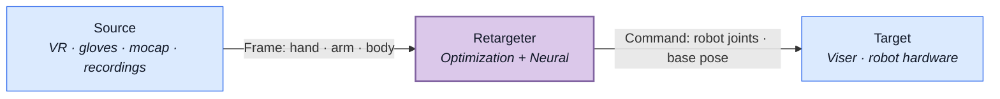

<p align="center">
  <a href="https://openrobokit.com/retargetingkit"></a>
</p>

<p align="center">
  <a href="pyproject.toml"></a>
  <a href="https://github.com/openrobokit/retargetingkit/actions/workflows/build.yml"></a>
</p>

RetargetingKit maps live or recorded human motion to robot hands, arms, and humanoids using [RoboKit](https://openrobokit.com/robokit) optimization and neural hand models.

The two main applications are:

- 🎮 **Real-time teleoperation**
- ⚡ **Offline retargeting in parallel**

## Quick links

- [Docs](https://openrobokit.com/docs/retargetingkit/overview/)
- [Quickstart](https://openrobokit.com/docs/retargetingkit/quickstart/)
- [Installation](https://openrobokit.com/docs/retargetingkit/install/)
- [Development](https://openrobokit.com/docs/retargetingkit/development/)

## Installation

Requires Python 3.10 or newer:

```shell
uv add retargetingkit      # or: pip install retargetingkit
```

See [Installation](https://github.com/openrobokit/retargetingkit/blob/main/docs/guide/installation.md) for source installs, extras, and asset access.

## Features

<table width="100%">
  <tr>
    <td width="50%" align="center" valign="top">
      <a href="https://openrobokit.com/docs/retargetingkit/hand-optimization/#work-with-trajectories"></a><br>
      <strong><a href="https://openrobokit.com/docs/retargetingkit/hand-optimization/#work-with-trajectories">Hand<br>retargeting</a></strong>
    </td>
    <td width="50%" align="center" valign="top">
      <a href="src/retargetingkit/gallery/hand_contact.py"></a><br>
      <strong><a href="src/retargetingkit/gallery/hand_contact.py">Geometry-aware hand<br>retargeting</a></strong>
    </td>
  </tr>
  <tr>
    <td width="50%" align="center" valign="top">
      <a href="https://openrobokit.com/docs/retargetingkit/humanoid-retargeting/"></a><br>
      <strong><a href="https://openrobokit.com/docs/retargetingkit/humanoid-retargeting/">Humanoid<br>retargeting</a></strong>
    </td>
    <td width="50%" align="center" valign="top">
      <a href="src/retargetingkit/gallery/humanoid_terrain.py"></a><br>
      <strong><a href="src/retargetingkit/gallery/humanoid_terrain.py">Geometry-aware humanoid<br>retargeting</a></strong>
    </td>
  </tr>
  <tr>
    <td width="50%" align="center" valign="top">
      <a href="https://openrobokit.com/docs/retargetingkit/full-body/"></a><br>
      <strong><a href="https://openrobokit.com/docs/retargetingkit/full-body/">Full-body<br>retargeting</a></strong>
    </td>
    <td width="50%" align="center" valign="top">
      <a href="https://openrobokit.com/docs/retargetingkit/full-body/#retarget-an-indoor-interaction"></a><br>
      <strong><a href="https://openrobokit.com/docs/retargetingkit/full-body/#retarget-an-indoor-interaction">Geometry-aware full-body<br>retargeting</a></strong>
    </td>
  </tr>
</table>

Explore recorded motions and robot presets in the [gallery examples](src/retargetingkit/gallery).

## How it works



| Component | Role | Read more |
| --- | --- | --- |
| Source | Read a device or recording and produce a canonical frame. | [Sources](https://openrobokit.com/docs/retargetingkit/pipeline/#three-stages) |
| Frame | Represent human hand, arm, or body motion. | [Frames](https://openrobokit.com/docs/retargetingkit/frames/) |
| Retargeter | Solve hand, arm, or body motion using RoboKit. | [Interfaces](https://openrobokit.com/docs/retargetingkit/protocols/) |
| Command | Carry robot joint positions and an optional base pose. | [Commands](https://openrobokit.com/docs/retargetingkit/ref-targets/) |
| Target | Preview commands or send them to a robot. | [Targets](https://openrobokit.com/docs/retargetingkit/ref-targets/) |

See the [framework overview](https://openrobokit.com/docs/retargetingkit/pipeline/) for frames, commands,
and named rigs.
