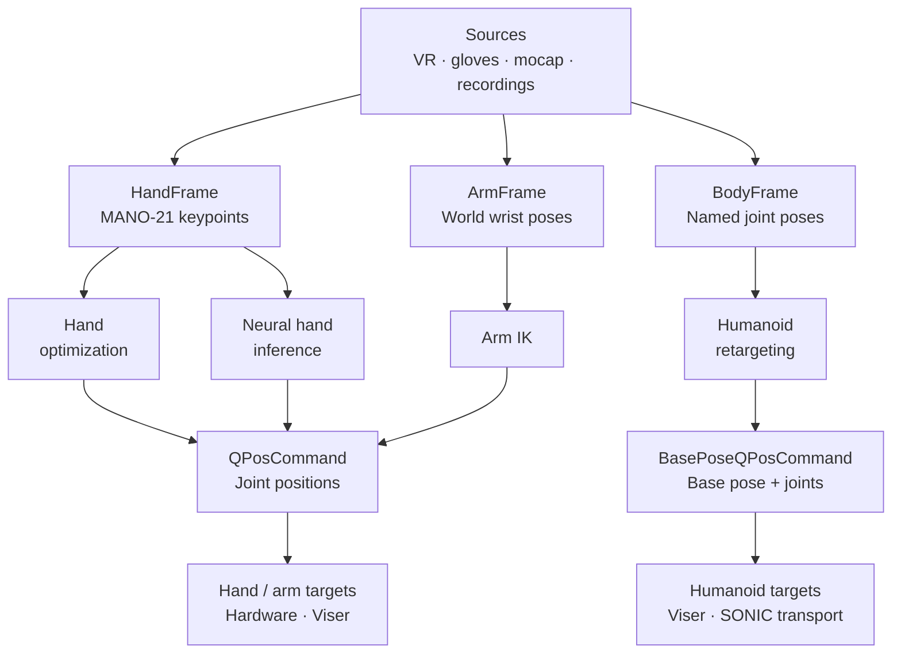

# Pipeline

RetargetingKit connects a motion source, a retargeter, and one or more targets. RoboKit provides the robot models and optimization tools used by the solvers.



On narrow screens, scroll horizontally to read the full diagram.

`ArmHandFrame` synchronizes wrist and finger observations from one source; the runtime sends its arm and hand frames through their respective solvers. SONIC forwards humanoid commands to a separate control process for simulation or G1 hardware.

## Three stages

| Stage | Responsibility | Examples |
| --- | --- | --- |
| Source | Convert device data or a recording into a canonical frame | Vision Pro, Manus, PICO, BVH |
| Retargeter | Map human motion to robot joints | Arm IK, hand optimization, neural hand, humanoid |
| Target | Display or send the result | Viser, robot hardware, SONIC transport |

A named **rig** supplies the matching source, solver, robot, and connection settings. The runtime builds them and runs the control loop. Start with a [named rig](../guide/teleoperation.md) for a complete workflow.

The diagram covers the canonical retargeting paths. [Quest 3](../reference/sources/quest3.md) has a standalone controller workflow. The [PICO body-and-hands rig](../reference/sources/pico.md) adds B/Y button commands for Inspire hand opening and closing alongside the body retargeter.

## Shared data

Frames describe human motion. Commands describe a single solved robot pose. The source handles device axes and joint ordering before a retargeter receives the frame.

Hands use wrist-local MANO-21 keypoints; arms use world-frame wrist poses; bodies use named joint poses in a Z-up world frame. See [Canonical frames](frames.md) for shapes and units.

## One loop

For an initialized hand source, matching retargeter, and joint-position target:

```python
frame = source.get_frame()
if frame is not None:
    command = retargeter.solve(frame)
    target.set_qpos(command.qpos)
```

Humanoid runtimes call `target.set_command(command)` so the target receives the base pose together with the joints. The runtime also owns startup and cleanup; the snippet shows only one update.

See [Interfaces](interfaces.md) to build a custom pipeline, or [RoboKit's robot model](https://github.com/openrobokit/robokit/blob/main/docs/concepts/robot.md) for the underlying kinematics.
