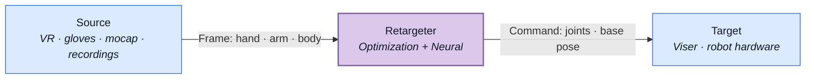

RetargetingKit maps human motion to robot hands, arms, and humanoids. It combines RoboKit optimization with neural hand models for recorded motion and real-time teleoperation.

## Key features

- **One pipeline.** Sources produce canonical motion frames; retargeters produce robot commands; targets preview or execute them.
- **Hands and bodies.** Solve finger motion, wrist poses, humanoid motion, and combined body-and-hand interactions.
- **Optimization + neural.** Choose geometry-aware optimization or trained hand inference for the task.
- **Recorded or live.** Retarget clips in parallel or drive robots from VR, gloves, and motion capture.

## How it works

| Component | Role | Read more |
| --- | --- | --- |
| Source | Read a device or recording. | [Sources](../concepts/pipeline.md) |
| Frame | Represent human hand, arm, or body motion. | [Frames](../concepts/frames.md) |
| Retargeter | Map motion to a robot through optimization or neural inference. | [Interfaces](../concepts/interfaces.md) |
| Command | Carry robot joints and an optional base pose. | [Commands](../reference/api/targets.md) |
| Target | Preview motion or command hardware. | [Targets](../reference/targets/xhand.md) |

## Features

|  |  |  |
| --- | --- | --- |
| **[Hand retargeting](hand_retargeting.md)** Map tracked hand motion to robot joints. | **[Geometry-aware hand retargeting](hand_retargeting.md#inspect-object-contact)** Refine hands against object geometry. | **[Real-time hand teleoperation](hand_retargeting.md#preview-live-motion)** Drive a robot hand from live tracking. |

|  |  |  |
| --- | --- | --- |
| **[Humanoid retargeting](humanoid_retargeting.md)** Map captured body motion to humanoids. | **[Geometry-aware humanoid retargeting](humanoid_retargeting.md)** Account for terrain and contact. | **[Real-time humanoid teleoperation](humanoid_retargeting.md)** Drive a humanoid from live motion. |

|  |  |  |
| --- | --- | --- |
| **[Full-body retargeting](full_body_retargeting.md)** Combine body and hand motion. | **[Geometry-aware full-body retargeting](full_body_retargeting.md#retarget-an-indoor-interaction)** Preserve scene and object interactions. | **[Real-time full-body teleoperation](humanoid_retargeting.md#control-both-inspire-hands)** Drive body and hands together. |

## Quick links

- [Quickstart](quickstart.md)
- [Installation](installation.md)
- [Framework concepts](../concepts/pipeline.md)
- [Asset setup](assets.md)
