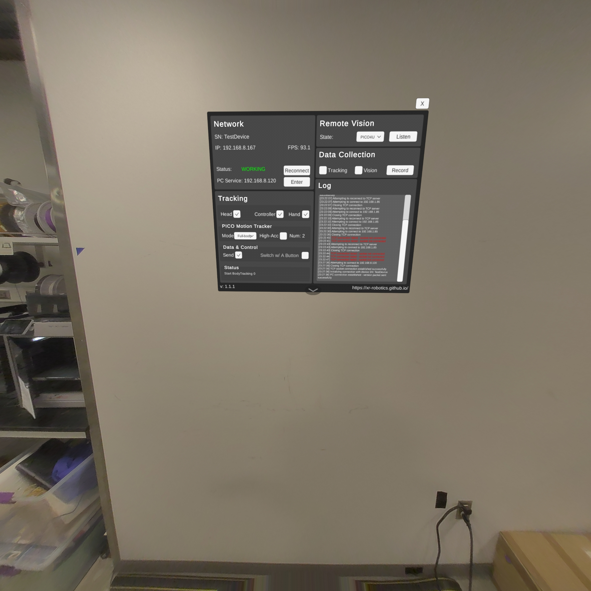

# PICO



Use PICO full-body tracking through XRoboToolkit to retarget a 24-joint body to Unitree G1. Record sessions for offline replay, or use controller buttons to open and close two Inspire hands alongside body motion.

`PicoSource` converts the SDK's Y-up poses to a canonical Z-up `BodyFrame`. The combined body-and-hands runtime uses **B** and **Y** buttons for the hands.

## Connect XRoboToolkit

Install [XRoboToolkit PC Service](https://github.com/XR-Robotics/XRoboToolkit-PC-Service/releases/latest), then install the pinned Python SDK from the RetargetingKit repository:

```shell
uv sync --extra pico
```

Start one foreground service and leave its terminal open. For the standard `/opt/apps/roboticsservice` installation:

```shell
cd /opt/apps/roboticsservice
env \
  LD_LIBRARY_PATH=/opt/apps/roboticsservice:/opt/apps/roboticsservice/lib:/opt/apps/roboticsservice/SDK/x64 \
  QT_PLUGIN_PATH=/opt/apps/roboticsservice/plugins \
  QT_QML_PATH=/opt/apps/roboticsservice/qml \
  ./RoboticsServiceProcess
```

Connect the workstation and PICO to the same Wi-Fi. In the headset's XRoboToolkit app, enter the workstation's Wi-Fi IPv4 address under **PC Service**, select **Reconnect** once, and apply these settings:

| Setting | Value |
| --- | --- |
| Head, Controller, Hand | Checked |
| Mode | Fullbody |
| High-Acc | Unchecked |
| Num | 2 |
| Send | Checked |
| Switch w/ A Button | Unchecked |
| Data Collection: Tracking, Vision | Unchecked |

Network **Status** should show **WORKING**. Any IP shown in a reference image is an example; enter your workstation's address.

## Check body tracking

In a second terminal, return to the RetargetingKit repository and run:

```shell
uv run --extra pico scripts/sources/pico/smoke_test.py --duration 5
```

Move your body during the test. It prints pelvis motion and a final 24-joint snapshot. If all poses remain frozen, fully close XRoboToolkit, recalibrate both trackers in the PICO Motion Tracker app, check that its avatar moves, and reopen XRoboToolkit.

## Preview G1

```shell
CUDA_VISIBLE_DEVICES=<FREE_GPU> uv run --extra pico --extra vis \
    scripts/teleop/humanoid.py pico_g1_sonic_viser \
    --source.no-use-ankle-as-foot-target --device cuda:0
```

Open <http://localhost:8080> to see G1 follow your motion. This rig also publishes to SONIC, but the preview runs without a SONIC process or physical robot hands.

Keep `--source.no-use-ankle-as-foot-target`: the PICO G1 profile is calibrated for PICO's separate foot joints, while the named presets still default to ankle targets. Set `--source.human-height` to the user's height in meters; the default is `1.75`.

## Record and replay

Record a 15-second body session:

```shell
uv run --extra pico scripts/sources/pico/record.py \
    --duration 15 --rate 50 --out pico_recording.npz
```

Replay it without a headset:

```shell
CUDA_VISIBLE_DEVICES=<FREE_GPU> uv run --extra vis \
    scripts/teleop/humanoid.py picofile_g1_sonic_viser \
    --source.path pico_recording.npz \
    --source.no-use-ankle-as-foot-target
```

The NPZ stores raw `poses` as `(N, 24, 7)` `float32`, `timestamps_s` as seconds since recording start, and JSON metadata with measured frame rate and joint names.

## Control body and hands

For G1 with two connected Inspire hands:

```shell
CUDA_VISIBLE_DEVICES=<FREE_GPU> uv run --extra pico --extra inspire \
    scripts/teleop/humanoid_hand.py pico_g1_inspire \
    --source.no-use-ankle-as-foot-target \
    --left-hand.serial-port <LEFT_PORT> \
    --right-hand.serial-port <RIGHT_PORT>
```

Press **B** to toggle the right hand or **Y** to toggle the left hand between open and closed. This runtime uses button commands, not the PICO hand skeleton. It publishes body commands to SONIC; see [humanoid teleoperation](../../guide/humanoid_retargeting.md) for simulation and G1 deployment. Press Ctrl-C to stop.

## Tracking format

The validated setup is PICO 4 Ultra with XRoboToolkit App 1.1.1, PC Service 1.0.0, and Python SDK 1.0.2. The wrapper converts arrays to finite `float32` values.

| Data | Shape | Format |
| --- | --- | --- |
| Headset or controller pose | `(7,)` | `[x, y, z, qx, qy, qz, qw]`; Y-up world, meters |
| Body poses | `(24, 7)` | 24 SMPL joints; same pose format |
| Body velocity or acceleration | `(24, 6)` | Linear XYZ followed by angular XYZ |
| Active hand poses | `(27, 7)` | 27 joints per hand |
| Joystick | `(2,)` | X/Y values |
| Motion Tracker pose | `(7,)` per tracker | Available in object-tracking mode |

Fullbody mode sends the inferred body skeleton rather than raw Motion Tracker poses. The SDK device timestamp is an integer count of nanoseconds.
