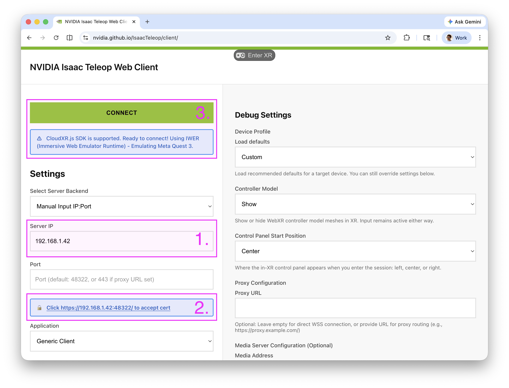
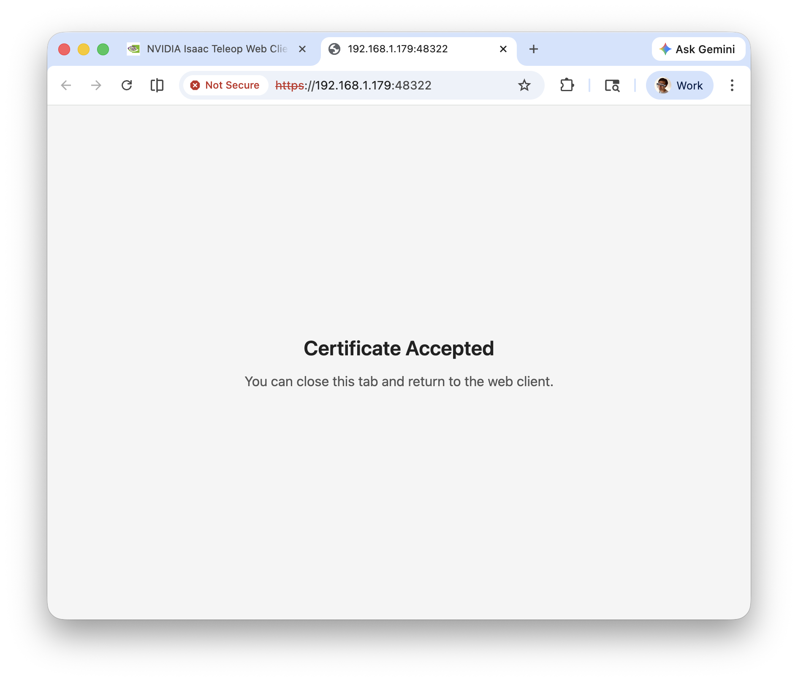
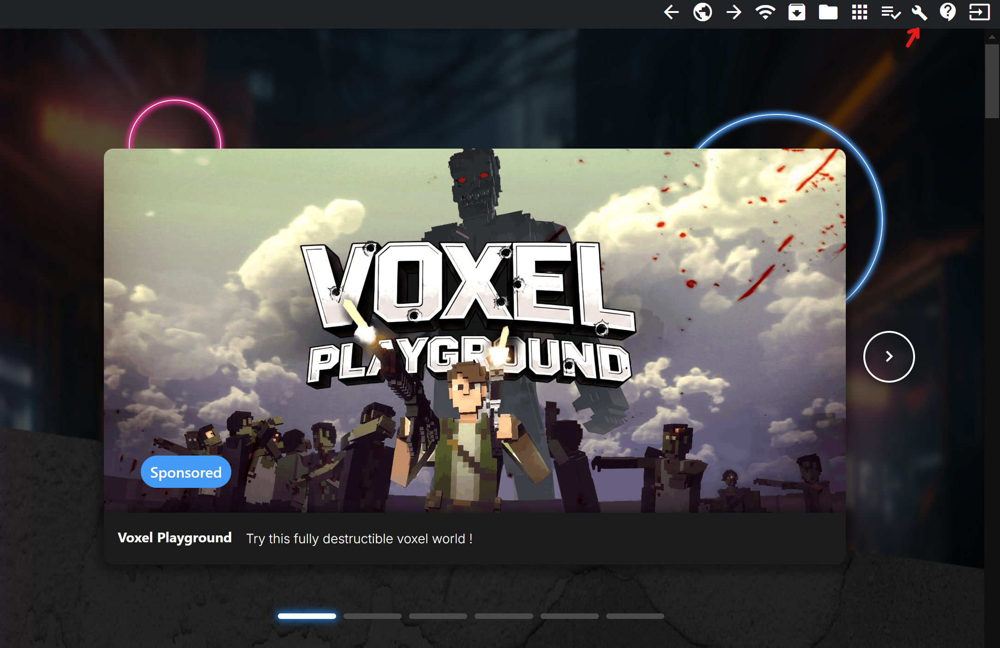
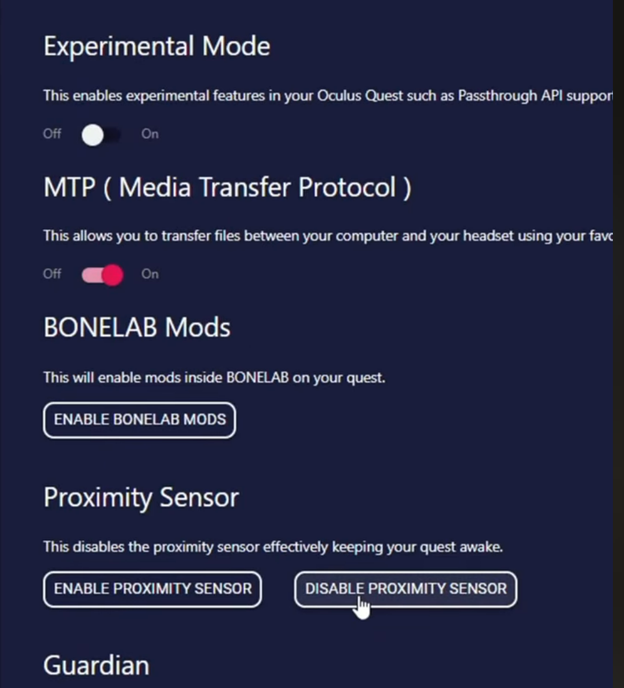

# Quest 3



Use Quest 3 controllers to move one or two xArm6 or xArm7 end effectors. Tracking comes through NVIDIA Isaac Teleop and CloudXR. The standalone playground supports a Viser preview, controller calibration, and hardware control.

## Connect CloudXR

From the RetargetingKit repository, install the playground dependencies and Isaac Teleop:

```shell
uv sync --extra vis --extra xarm
uv pip install "isaacteleop[cloudxr,retargeters]~=1.0.0" \
    --extra-index-url https://pypi.nvidia.com
```

Start CloudXR, then load its environment in the terminal used for teleoperation:

```shell
uv run --no-sync python -m isaacteleop.cloudxr --accept-eula
. ~/.cloudxr/run/cloudxr.env
```

The commands on this page use `--no-sync` to keep the installed Isaac Teleop environment. If a firewall is active, allow the CloudXR ports:

```shell
sudo ufw allow 47998/udp
sudo ufw allow 49100,48322/tcp
```

Open the [Isaac Teleop WebXR client](https://nvidia.github.io/IsaacTeleop/client) in the headset browser. Enter the workstation IP, accept its generated certificate, and select **Connect**, then **Play**.



## Check tracking

```shell
uv run --no-sync python scripts/sources/quest3/stream.py --side both
```

Move each controller and check that its position and orientation change. Output includes XYZ position and a quaternion in `wxyz` order; `invalid` means that controller is not tracked. Use `--side right` or `--side left` to inspect one controller.

## Preview an arm

```shell
uv run --no-sync python scripts/sources/quest3/teleop.py \
    --mode single --single-side right --visualize
```

Open <http://localhost:8080>. Align the controller with the displayed end effector, then press **B** to calibrate and start following your motion. The default translation scale is `0.50`.

| Controller action | Right | Left |
| --- | --- | --- |
| Calibrate; then pause or resume | B | Y |
| Return to the calibrated pose | A | X |

## Connect xArm hardware

Run a single xArm7:

```shell
uv run --no-sync python scripts/sources/quest3/teleop.py \
    --mode single --single-side right \
    --arm-ip <XARM_IP> --translation-scale 0.50
```

For two arms, set both xArm IPs:

```shell
uv run --no-sync python scripts/sources/quest3/teleop.py \
    --mode bimanual \
    --right-xarm-ip <RIGHT_IP> --left-xarm-ip <LEFT_IP> \
    --translation-scale 0.50
```

Use `--arm xarm6` to select xArm6. Each arm moves to its home pose during startup; calibrate its controller afterward. Press Ctrl-C to stop. Quest uses this standalone script rather than a named rig under `scripts/teleop/`.

## Keep the headset awake





For long sessions, enable developer mode, connect SideQuest over USB, and disable the proximity sensor in **Device Settings & Tools**.
