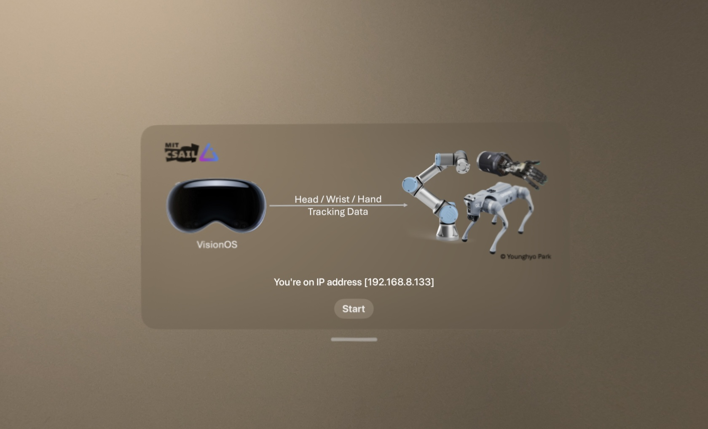
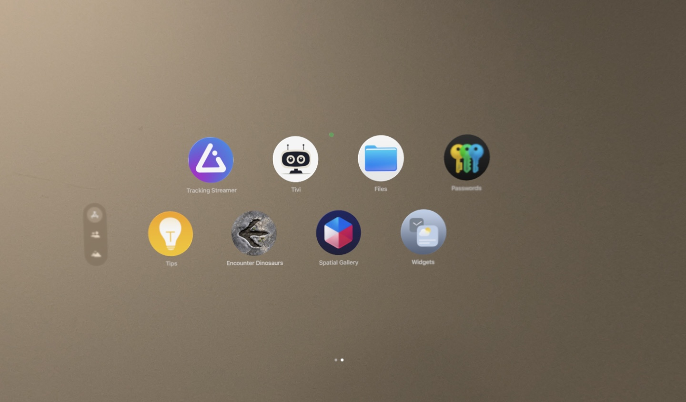

# Apple Vision Pro



Stream head, wrist, and finger tracking from Apple Vision Pro with `avp_stream`. RetargetingKit can drive robot hands, robot arms, or synchronized arm-and-hand assemblies, and replay the same tracking from a recording.

| Motion | Runtime | Example rig |
| --- | --- | --- |
| Fingers | `scripts/teleop/hand.py` | `visionpro_sharpa` |
| Wrists | `scripts/teleop/arm.py` | `visionpro_xarm7` |
| Wrists and fingers | `scripts/teleop/arm_hand.py` | `visionpro_xarm7_xhand` |

## Connect the headset



1. Connect the workstation and Vision Pro to the same Wi-Fi network.
2. Open **Tracking Streamer** on Vision Pro.
3. Note its IP address and select **Start**. Use that address as `<VISION_PRO_IP>` below.
4. Install the source dependencies from the RetargetingKit repository:

```shell
uv sync --extra vision-pro
```

Check the live stream:

```shell
uv run --extra vision-pro scripts/sources/vision_pro/stream.py \
    --ip <VISION_PRO_IP>
```

The terminal prints head position and left/right pinch distances. Move your head and pinch each hand to check the values.

## Preview retargeting

Run a right xArm7 with XHand in Viser:

```shell
CUDA_VISIBLE_DEVICES=<FREE_GPU> uv run --extra vision-pro \
    scripts/teleop/arm_hand.py visionpro_xarm7_xhand \
    --source.ip <VISION_PRO_IP> --mode viser
```

Open <http://localhost:8080>. The first tracked wrist frame becomes the calibration origin and maps to the arm's home pose. Finger motion drives the robot hand.

For arm-only or hand-only retargeting:

```shell
CUDA_VISIBLE_DEVICES=<FREE_GPU> uv run --extra vision-pro \
    scripts/teleop/arm.py visionpro_xarm7 --source.ip <VISION_PRO_IP>

CUDA_VISIBLE_DEVICES=<FREE_GPU> uv run --extra vision-pro \
    scripts/teleop/hand.py visionpro_sharpa --source.ip <VISION_PRO_IP>
```

The arm runtime also offers `visionpro_xarm6` and `visionpro_dual_xarm7`. The hand runtime offers `visionpro_xhand` and `visionpro_sharpa`. All default to Viser.

## Connect hardware

Use `--mode both` to send the same targets to hardware and Viser:

```shell
CUDA_VISIBLE_DEVICES=<FREE_GPU> uv run --extra vision-pro --extra xarm \
    scripts/teleop/arm_hand.py visionpro_xarm7_xhand \
    --source.ip <VISION_PRO_IP> --mode both \
    --arms.right.ip <XARM_IP> \
    --hands.right.serial-port /dev/ttyUSBX
```

Each arm moves to its model-specific home pose at startup. Hold the wrist at the desired tracking origin when the first frame is read. Use `--mode real` for hardware only; press Ctrl-C to stop.

| Assembly | Named rig | Hand connection |
| --- | --- | --- |
| xArm7 + XHand | `visionpro_xarm7_xhand`, `visionpro_dual_xarm7_xhand` | `--hands.right.serial-port` |
| xArm7 + Ability Hand | `visionpro_xarm7_ability` | `--hands.right.port`; add `--extra ability` |
| xArm7 + Inspire Hand | `visionpro_xarm7_inspire` | `--hands.right.serial-port`; add `--extra inspire` |
| xArm7 + Sharpa Wave | `visionpro_xarm7_sharpa` | `--hands.right.device-sn` |
| xArm6 + Sharpa Wave | `visionpro_xarm6_sharpa` | `--hands.right.device-sn` |

Single-arm presets use the right side. For the dual XHand rig, also set `--arms.left.ip` and `--hands.left.serial-port`. Sharpa uses the first discovered hand when its device serial number is unset.

To tune arm-and-hand motion, use `--arm-retargeters.right.translation-scale` for wrist translation and `--arm-retargeters.right.ee-gain` for pose smoothing. The arm-only runtime uses `--retargeters.right.translation-scale` and `--retargeters.right.ee-gain`.

## Record and replay

Record 15 seconds at a requested 50 Hz:

```shell
uv run --extra vision-pro scripts/sources/vision_pro/record.py \
    --ip <VISION_PRO_IP> --duration 15 --rate 50 \
    --output data/vision_pro.pkl
```

Replay with the original rate:

```shell
CUDA_VISIBLE_DEVICES=<FREE_GPU> uv run --extra vision-pro \
    scripts/teleop/arm.py visionpro_xarm7 \
    --source.recording-path data/vision_pro.pkl \
    --source.recording-fps 50
```

The pickle contains tracking dictionaries without timestamps or frame-rate metadata. Always set `--source.recording-fps` to the recording rate. Playback holds the final frame when it reaches the end.

To inspect the recorded skeleton directly:

```shell
uv run --extra vision-pro scripts/sources/vision_pro/visualize.py \
    --recording data/vision_pro.pkl
```

This viewer and `stream.py --recording <FILE>` use the device API's fixed default of 20 Hz, so a 50 Hz recording plays more slowly.

## Tracking format

The validated `avp_stream` 2.51 format uses finite `float64` values. Translations are in meters and wrist roll is in radians.

| Field | Shape | Coordinate frame |
| --- | --- | --- |
| `head` | `(1, 4, 4)` | World |
| `left_wrist`, `right_wrist` | `(1, 4, 4)` | World |
| `left_fingers`, `right_fingers` | `(25, 4, 4)` | Wrist-local |
| `left_arm`, `right_arm` | `(25, 4, 4)` or `(27, 4, 4)` | Wrist-local; optional two forearm joints |
| `left_pinch_distance`, `right_pinch_distance` | scalar | Thumb-tip to index-tip distance |
| `left_wrist_roll`, `right_wrist_roll` | scalar | Wrist roll |

The streamer converts world poses from Y-up to right-handed Z-up: `x'=x`, `y'=-z`, `z'=y`. Finger and arm matrices stay wrist-local. The 25-joint order is wrist, four thumb joints, then five joints each for index, middle, ring, and little fingers. The optional final two arm joints are `forearmWrist` and `forearmArm`.
